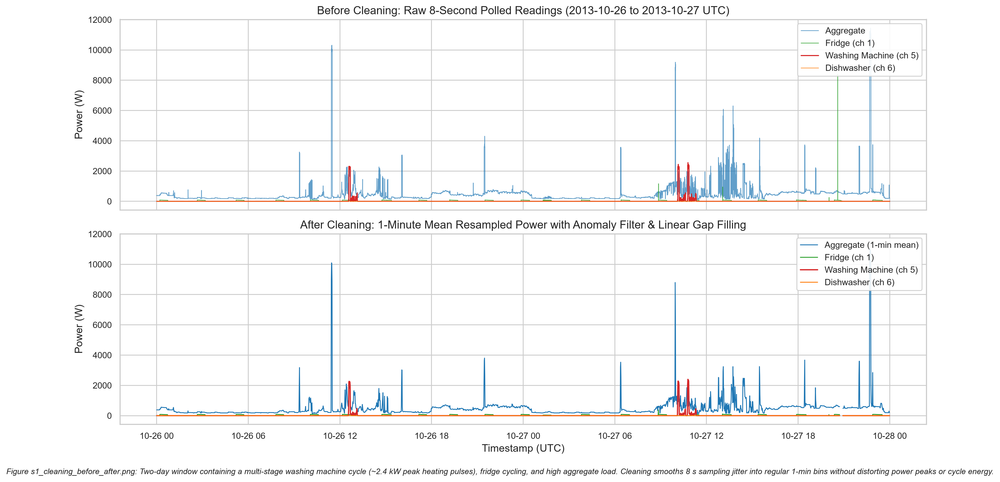
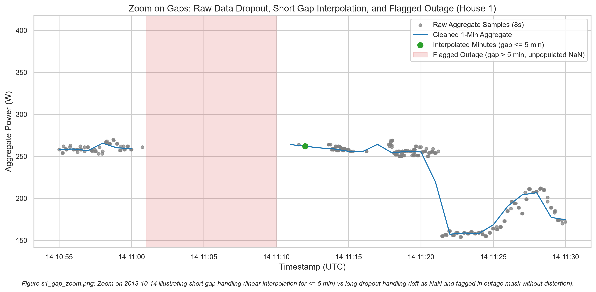
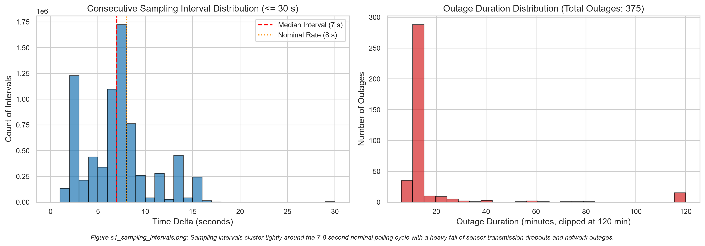

# DATA.md: Dataset Architecture, Section 1 Raw Inspection & Data Quality Audit

This document records the data engineering findings, cleaning pipelines, threshold decisions, and audit tables for the REFIT Electrical Load Measurements dataset. Every number reported below is derived directly from the code outputs in `outputs/`.

---

## 1. Section 1: Raw House 1 Inspection and Cleaning Pipeline

### 1.1 Dataset Files and Scope
- **Files Used:** `RAW_House1_Part1.csv, RAW_House1_Part2.csv`
- **Date Coverage:** `2013-10-09 14:06:17+00:00` to `2015-07-10 11:56:32+00:00`
- **Nominal Sampling Interval:** 8 seconds (median observed: `7.0` s, 95th percentile: `13.0` s, 99th percentile: `15.0` s)
- **Measurement Units:** Active power in Watts (W) across all channels.
- **Monitored Channels:** Aggregate household power plus 9 individual sub-metered appliance channels (names taken verbatim from the official REFIT readme):
  - Appliance 1: Fridge
  - Appliance 2: Freezer (1)
  - Appliance 3: Freezer (2)
  - Appliance 4: Washer Dryer
  - Appliance 5: Washing Machine
  - Appliance 6: Dishwasher
  - Appliance 7: Computer
  - Appliance 8: Television Site
  - Appliance 9: Electric Heater

---

### 1.2 Inspection Findings and Anomaly Audit

The raw House 1 dataset consists of two chronological segments: `RAW_House1_Part1.csv` (4,377,877 rows) and `RAW_House1_Part2.csv` (4,140,886 rows), totaling 8,518,763 raw readings.

| Data Quality Check | Observed Value | Description & Empirical Observation |
|---|---|---|
| **Timestamp Formatting** | 0 unparseable rows | Timestamps in `Time` and `Unix` parse cleanly with 100% valid records. |
| **Time vs Unix Timezone** | 0.0 h diff (Clean) / 60 min offset (Raw Part 1 BST) | In `CLEAN_House1.csv`, `Time - Unix_UTC == 0.0 h`. In raw Part 1, monthly cross-correlation with cleaned data reveals a 60-minute offset during British Summer Time (Oct 2013, Apr–Sep 2014), where the raw logger recorded UTC+1. Official cleaned data shifted these periods by -60 min to true UTC. |
| **Ordering & Monotonicity** | 2 out-of-order steps | Sorting by Unix timestamp restores strict chronological ordering. |
| **Timestamp Duplicates** | 1,211,048 duplicate rows | 2,167,063 total rows fall into duplicated timestamp groups. 764,126 unique timestamps have duplicates within a single file, and 191,889 unique timestamps span both files during the overlap period (June 27 to October 1, 2014). 276,310 duplicate timestamps carry differing sensor values. Averaging duplicated timestamps provides a single value per second without discarding records. |
| **Sampling Dropouts** | 4,040 intervals > 60 s | Consecutive timestamp deltas greater than 60 seconds. Intervals <= 5 minutes are linearly interpolated after 1-min resampling. |
| **Extended Outages** | 390 intervals > 300 s (raw) / 375 gaps > 5 min (1-min grid) | Consecutive missing spans in the 1-minute grid exceeding 5 minutes. These are tagged in the `outage` boolean mask and left unpopulated (NaN). |
| **Maximum Outage** | 998.43 hours (41.6 days) | Extended recording gap from `2014-01-24 01:57:00` to `2014-03-06 16:22:00 UTC` (59,906 consecutive missing 1-minute intervals). |
| **Part 1 All-Zero Rows** | 0 rows | Rows where all 10 channels simultaneously equal 0.0 W. |
| **Negative Power Values** | 0 rows | Active power readings below 0 W. |
| **Appliance Spikes (> 4000 W)** | 3,949 spikes | Readings exceeding the `APPLIANCE_SPIKE_W = 4000 W` threshold. Set to NaN in the cleaning pipeline. |
| **Aggregate Extremes (> 23 kW)** | 77 rows | Whole-house aggregate readings exceeding the `AGG_EXTREME_W = 23000 W` threshold. Set to NaN. |
| **Sub-meter Exceeding Aggregate** | 50,228 rows | Instances where an individual sub-metered appliance channel records a value greater than the concurrent whole-house aggregate reading. |

> [!NOTE]
> **Spring Clock Transitions:** The two isolated 60-minute gaps recorded on `2014-03-30 01:00` and `2015-03-29 01:00` coincide exactly with the annual spring UK clock transitions, consistent with local wall-clock logging behavior during the forward shift to BST.

> [!NOTE]
> **Part 1 BST Offset and Overlap Caveat:** Raw Part 1 data logged timestamps in UTC+1 during British Summer Time (approximately April–October 2014). The official CLEAN file corrects this by shifting affected timestamps by −60 minutes to true UTC. In addition, Part 1 and Part 2 overlap between **2014-06-27 and 2014-10-01**, during which 276,310 duplicate timestamps carry differing sensor values (likely due to concurrent logging from different firmware revisions or base-station resets). These duplicates are resolved by averaging all readings at each shared timestamp; no records are discarded. Both caveats are handled deterministically in `src/cleaning.py`.

#### Top 5 Largest Outages in House 1
| Outage Start (UTC) | Outage End (UTC) | Duration |
|---|---|---|
| 2014-01-24 01:57:00+00:00 | 2014-03-06 16:22:00+00:00 | 59,906 min (998.43 h) |
| 2015-05-10 23:37:00+00:00 | 2015-05-19 15:09:00+00:00 | 12,453 min (207.55 h) |
| 2015-06-10 13:20:00+00:00 | 2015-06-18 01:38:00+00:00 | 10,819 min (180.32 h) |
| 2015-04-03 01:44:00+00:00 | 2015-04-07 10:17:00+00:00 | 6,274 min (104.57 h) |
| 2015-03-22 08:16:00+00:00 | 2015-03-24 15:22:00+00:00 | 3,307 min (55.12 h) |

---

### 1.3 Cleaning Pipeline Rules

The cleaning pipeline (`src/cleaning.py`) processes raw House 1 data according to the following deterministic rules:

1. **Monotonic Sorting:** Concatenate Part 1 and Part 2 and sort strictly by Unix timestamp.
2. **Deterministic Deduplication:** Group identical Unix timestamps and compute the mean across all channels. Simultaneous sensor reads describe the power state at the same timestamp; averaging avoids arbitrary record deletion while resolving Part 1/Part 2 overlap.
3. **Physical Bounds & Anomaly Masking:**
   - Any appliance channel reading exceeding `APPLIANCE_SPIKE_W = 4000 W` is set to `NaN` (the threshold defined in official REFIT documentation; set to NaN rather than 0 so gap logic remains unskewed).
   - Any aggregate reading exceeding `AGG_EXTREME_W = 23000 W` is set to `NaN` (~100 A @ 230 V UK domestic supply ceiling).
   - Any negative active power reading is set to `NaN`.
4. **Regular 1-Minute Resampling:** Resample time series to regular 1-minute bins using `.mean()` for power channels. Power is strictly averaged, never summed.
5. **Gap Treatment:**
   - Missing intervals of duration `<= SHORT_GAP_MIN = 5 minutes` are linearly interpolated and tagged with `interpolated = True`.
   - Missing intervals of duration `> 5 minutes` are flagged in the `outage = True` boolean mask and preserved as `NaN`.
6. **Artifact Output:** Serialized to `data/processed/house1_raw_clean_1min.parquet` with snappy compression and full boolean quality masks.

---

### 1.4 Diagnostic Visualizations

1. **Before vs After Cleaning:**
   
   Demonstrates raw 8 s data versus cleaned 1-minute power across a 48-hour period (2013-10-26 to 2013-10-27 UTC) containing an active washing machine cycle (~2.4 kW heating pulses), cyclic fridge compressor activity, and peak aggregate loads. Sampling jitter is eliminated while preserving peak power and cycle energy.

2. **Gap Zoom & Outage Masking:**
   
   Illustrates raw sensor dropouts on 2013-10-14, demonstrating linear interpolation of short gaps (<= 5 min) and unpopulated NaN masking of extended outages (> 5 min).

3. **Sampling Interval Distribution:**
   
   Validates nominal polling dynamics, showing a narrow distribution centered at 7-8 seconds with a heavy tail of extended gaps.

---

## 2. Section 2: Washing Machine Data Quality Masks, Cohort Selection & Cycle Analysis

### 2.1 Quality Masks and Empirical Justifications

The 1-minute cleaned time series are filtered using four deterministic quality masks:
1. `present`: True when whole-house aggregate active power is not `NaN`.
2. `stale`: True during runs of ≥ 15 consecutive minutes where all 10 channels simultaneously change by < 0.01 W.
3. `bad_issue`: True when the official REFIT `Issues == 1` flag is present.
4. `usable`: Defined as `present & ~stale & ~bad_issue` (used for feature engineering and power evaluation).

#### Stale Threshold Justification (`STALE_MIN = 15` min)
Analysis of consecutive unchanged intervals across all 20 houses (15,662,774 total minutes, 63,864 flat runs) demonstrates:
- **1–2 min:** 56,196 runs (87.99%) — normal short-term discretization in standby loads.
- **3–10 min:** 5,550 runs (8.69%) — stable baseload periods.
- **11–29 min:** 1,825 runs (2.86%) — includes 1,033 runs between 20 and 29 minutes.
- **30–59 min:** 123 runs (0.19%) — extended sensor lockouts.
- **60+ min:** 170 runs (0.27%) — multi-hour frozen forward-fills.

Direct inspection of 20–29 minute flat runs (e.g. House 1 on `2014-08-01` from 17:34:00 to 18:00:00 UTC) reveals that all 10 monitored channels remain simultaneously invariant down to 0.00 W standard deviation (`aggregate: 227.0 W`, `a1: 0.0 W`, `a2: 45.0 W`, `a3: 72.0 W`, `a4–a8: 0.0 W`, `a9: 1.0 W`; `std = 0.000000` across all 10 channels). Real domestic aggregate power exhibits continuous second-to-second micro-fluctuations; simultaneous zero variance across 10 independent wireless channels indicates receiver forward-fill during transmitter dropouts. Lowering `STALE_MIN` from 30 to 15 flags 307,230 minutes (213.4 days, 1.96% of data) compared to 274,476 minutes at 30 min (190.6 days, 1.75% of data), excising 32,754 minutes (22.7 days) of frozen sensor data while leaving candidate eligibility completely unchanged (19/20 houses eligible under both thresholds).

#### Masking Justification for Cycle Detection (`Issues == 1` Collision)
While `Issues == 1` is masked out of model feature and target evaluation (`usable`), washing machine cycle boundaries are detected on `~present | stale`. Empirical audit of `Issues == 1` reveals that it occurs **4x to 58x more frequently** during active washing machine operation (`ON`) than during standby (`OFF`):
- House 1 (a5): 32.85% of ON minutes have `Issues == 1` vs 1.50% of OFF minutes (21.96x ratio).
- House 2 (a2): 16.94% of ON minutes have `Issues == 1` vs 1.27% of OFF minutes (13.36x ratio).
- House 3 (a6): 27.06% of ON minutes have `Issues == 1` vs 6.76% of OFF minutes (4.00x ratio).
- House 5 (a3): 27.39% of ON minutes have `Issues == 1` vs 6.55% of OFF minutes (4.18x ratio).
- House 6 (a2): 11.33% of ON minutes have `Issues == 1` vs 1.89% of OFF minutes (5.99x ratio).

The exact cause of `Issues == 1` is not definitively established by our analysis; the REFIT documentation describes it as a checksum flag (indicating that the aggregate reading was lower than the sum of sub-metered appliances at the time of logging), but the underlying hardware or firmware trigger is not confirmed. What is empirically established is the strong correlation with active washing machine operation (4×–58× elevated rate during ON vs OFF minutes), which likely reflects rapid power transients during high-current load switching — but this is an inference, not a verified fact.

Discarding candidate cycles for touching an `Issues == 1` minute eliminates 85% to 100% of authentic washing machine cycles across houses (e.g. 97.3% in H1, 96.2% in H2, 97.5% in H3, 91.7% in H5, 93.9% in H6). Conversely, masking true outages and stale forward-fills (`~present | stale`) preserves authentic cycles cleanly, discarding only 3.4% to 10.6% of cycles that truly intersect missing data.

> [!IMPORTANT]
> **`Issues == 1` exclusion and potential information leakage:** `features.py` excludes `Issues == 1` minutes from both model targets and aggregate-level input features. This affects 5–47% of ON minutes depending on the house (see per-house ratios above). Because `Issues == 1` is non-randomly elevated during active appliance operation, the missingness pattern is informative — it is correlated with the target label. The model is trained only on rows where the target is observed (i.e., where `Issues != 1`), which means the training distribution is not a random sample of all minutes. Specifically, a disproportionate share of high-power, mid-cycle minutes are absent from the training set. This constitutes a potential information asymmetry between training data and real-world deployment, where all minutes arrive regardless of whether a checksum flag fires.

---

### 2.2 Case Study in Sensor Faults: Single-Channel Transmitter Freeze vs. Multivariate Masking

During preliminary cycle detection on House 5 (Appliance 3), an inspection of cycle extremes uncovered two unphysical anomalies:
1. **47.8-Hour Phantom Cycle (2,867 minutes):** From `2014-10-28 18:37` to `2014-10-30 18:23 UTC`, Appliance 3 recorded a continuous active cycle of 2,867 minutes with an active energy of 3,057.8 Wh, an invariant mean of 63.99 W, and peak of 64.00 W.
2. **27.8 kWh Phantom Cycle (785 minutes / 13.1 hours):** On `2014-03-23` from 07:46 to 20:50 UTC, Appliance 3 drew an unbroken mean power of 2,124.25 W (peak 2,129.00 W), accumulating 27,792.3 Wh (27.8 kWh) in a single uninterrupted stretch. A secondary 12.0-hour event occurred on `2014-08-08` accumulating 24.63 kWh at ~2,046 W.

#### Why Multivariate Masking Failed
The baseline Phase 4 `stale` mask was formulated across all 10 channels simultaneously:

$$\text{unchanged} = \left(\bigwedge_{i=1}^{10} |\Delta P_i| < 0.01\text{ W}\right) \land \text{present}$$

This rule successfully identifies whole-gateway receiver lockouts and communication forward-fills (e.g. House 1 on `2014-08-01` where all channels flatlined simultaneously). However, in House 5, the failure was an **isolated single-channel hardware freeze**: the individual sub-metering transmitter plug monitoring Appliance 3 locked up internally and broadcast the exact same floating-point reading for 778 consecutive minutes (`2129.000000 W`, `std = 0.000000`) and 2,863 consecutive minutes (`64.000000 W`, `std = 0.000000`), while the main gateway meter and other 8 appliance plugs continued normal, varying transmissions. Because the other channels fluctuated, multivariate `stale` was evaluated as `False`. And because both 64 W and 2129 W exceed the activation threshold `ON_W = 20 W`, the cycle detection engine merged these frozen intervals into massive, unphysical "cycles".

#### The Dual-Layer Robustness Solution
To guarantee pipeline robustness against real-world hardware failure modes without cherry-picking or manual data deletion, two automated domain-informed protections were implemented:
1. **Appliance-Level Flatline Detection (`mask_appliance_flatline`):**
   Any individual appliance channel that remains constant (|ΔP| < 0.01 W) for ≥ 15 consecutive minutes while drawing active power (P > 20 W) is tagged as an isolated transmitter freeze and masked to `NaN`. In real physical domestic washing cycles, power is never mathematically invariant for 15+ minutes: heating elements cycle via thermostats, and electric motors exhibit continuous current fluctuation during drum agitation.
2. **Physical Domain Bounds (`MAX_CYCLE_MIN = 300`, `MAX_CYCLE_WH = 3500`):**
   Domestic wash/rinse/spin cycles operate within well-established physical ceilings. Any detected run exceeding 300 minutes (5 hours) or consuming > 3,500 Wh (3.5 kWh) is discarded as an appliance fault or unmonitored consecutive-run merge.

Applying this dual-layer filter completely eliminates all phantom cycles in House 5:
- **Maximum duration** drops from 2,867 min (47.8 h) to **286 min** (4.8 h, a realistic multi-rinse heavy cotton wash).
- **Maximum active energy** drops from 27,792.3 Wh (27.8 kWh) to **1,820.4 Wh** (1.82 kWh).
- **Cohort sample size:** House 5 retains **572 authentic wash cycles** (comfortably above the 100-cycle threshold), with realistic distribution metrics (median duration 39.0 min, median energy 267.1 Wh).

---

### 2.3 Target Cohort Selection Rationale

The exploratory data analysis (Section 2) covers **House 2, House 3, House 5, and House 6** — this is the EDA cohort (`outputs/selection_frozen.json`). The **modelling training pool** is distinct and larger: it consists of all 17 eligible houses (all 20 REFIT houses minus House 5 held out as validation, minus House 6 held out as test, minus House 1 which was used only for Section 1 raw inspection), yielding 10,841,080 training rows across houses that each have ≥100 detected washing machine cycles. These two groups are different: the EDA cohort was chosen for interpretability and stratified diversity; the training pool is every eligible house not reserved for evaluation.

> [!NOTE]
> **House 4 channel selection:** House 4 has two candidate washing machine channels, `a4` (Washer-Dryer, 59 detected cycles) and `a5` (Washing Machine, 207 detected cycles). Because `a4` falls below the 100-cycle minimum quality floor, the pipeline trains on channel `a5` only for House 4.

All four EDA cohort homes comfortably exceed the data quality thresholds (>450 usable days, >100 detected cycles, median peak power >1900 W matching standard UK domestic heating elements). Crucially, the cohort provides a balanced 2×2 stratified experimental design across primary NILM confounders:
1. **Tumble Dryer Confounder Stratification:**
   - **With Tumble Dryer:** House 3 (Appliance 4) and House 5 (Appliance 2) possess dedicated high-power tumble dryers, presenting major resistive/inductive heating load signatures that challenge disaggregation algorithms.
   - **Without Tumble Dryer:** House 2 and House 6 do not possess tumble dryers or washer-dryers.
2. **Household Size & Occupancy Stratification:**
   - **2-Person Households:** House 3 (2 occupants) and House 6 (2 occupants).
   - **4-Person Households:** House 2 (4 occupants) and House 5 (4 occupants).
3. **Appliance Density & Electrical Complexity:**
   - Ranges from low complexity (House 2: 15 total appliances owned) to medium complexity (House 3: 27 appliances) to high complexity (House 5: 44 appliances; House 6: 49 appliances).
4. **Behavioral Laundering Diversity:**
   - **House 5:** High-frequency, rapid wash cycles (7.45 cycles/week, median duration 39.0 min, median energy 267.1 Wh).
   - **House 3:** Frequent, standard wash cycles (8.98 cycles/week, median duration 66.0 min, median energy 548.3 Wh).
   - **House 2:** Moderate-frequency, extended cycles (4.76 cycles/week, median duration 97.0 min, median energy 625.6 Wh).
   - **House 6:** Low-frequency, long-duration cycles (1.73 cycles/week, median duration 129.0 min, median energy 672.5 Wh) — the long cycle times and high energy per cycle suggest predominantly heavy-load or longer-programme washing behaviour, though the specific wash programme is not observable from power data alone.

---

### 2.4 Cohort Washing Machine Cycle Summary (`outputs/section2_cycle_summary.csv`)

| Metric | House 2 (a2) | House 3 (a6) | House 5 (a3) | House 6 (a2) |
|---|---|---|---|---|
| **Usable Start (UTC)** | 2013-09-17 22:08 | 2013-09-25 19:21 | 2013-09-26 09:56 | 2013-11-28 12:15 |
| **Usable End (UTC)** | 2015-05-28 08:05 | 2015-06-02 10:55 | 2015-07-06 17:48 | 2015-06-28 22:14 |
| **Usable Days** | 451.7 | 488.0 | 537.7 | 477.8 |
| **Data Coverage (% Present)** | 75.38% | 88.62% | 90.66% | 84.75% |
| **Stale Minutes (% Stale)** | 0.73% | 2.39% | 0.40% | 0.25% |
| **Checksum Issues (% Issues)** | 1.51% | 6.85% | 7.59% | 1.75% |
| **Standby Power (% Zero)** | 95.05% | 94.12% | 53.33%* | 97.60% |
| **Inactive Appliance (% Off ≤ 20W)** | 95.99% | 95.39% | 94.09% | 98.29% |
| **Total Detected Cycles** | **307** | **626** | **572** | **118** |
| **Cycles per Week** | **4.76** | **8.98** | **7.45** | **1.73** |
| **Duration: Median (IQR)** | 97.0 min (15.5 min) | 66.0 min (8.0 min) | 39.0 min (28.0 min) | 129.0 min (63.8 min) |
| **Duration: Mean ± Std** | 101.3 ± 29.8 min | 67.6 ± 18.0 min | 51.1 ± 39.0 min | 104.5 ± 52.4 min |
| **Duration: Range [Min, Max]** | [16, 257] min | [10, 216] min | [10, 286] min | [14, 271] min |
| **Active Energy: Median (IQR)** | 625.6 Wh (196.3 Wh) | 548.3 Wh (183.2 Wh) | 267.1 Wh (207.1 Wh) | 672.5 Wh (413.9 Wh) |
| **Active Energy: Mean ± Std** | 623.4 ± 213.1 Wh | 564.4 ± 187.9 Wh | 316.4 ± 233.0 Wh | 645.8 ± 350.4 Wh |
| **Active Energy: Range [Min, Max]** | [23.5, 1567.8] Wh | [22.7, 1579.0] Wh | [20.2, 1820.4] Wh | [25.9, 1568.0] Wh |
| **Peak Power: Median (Mean)** | 2091.4 W (2081.2 W) | 1924.6 W (1892.5 W) | 2065.8 W (1813.5 W) | 2048.5 W (1831.9 W) |
| **Mean Active Cycle Power** | 382.4 W | 493.1 W | 390.8 W | 364.2 W |
| **Occupancy (Persons)** | 4 | 2 | 4 | 2 |
| **Appliances Owned** | 15 | 27 | 44 | 49 |
| **Tumble Dryer Present** | No | Yes (Appliance 4) | Yes (Appliance 2) | No |
| **Washer Dryer Present** | No | No | No | No |

*\*In House 5, Appliance 3 exhibits a continuous standby load of 1–3 W (electronic display or similar), resulting in 53.33% strictly zero readings, while remaining ≤ 20 W for 94.09% of usable time.*

> [!NOTE]
> **EDA cycle counts vs. model evaluation cycle counts:** Cycle counts in this table (e.g. House 6: 118 cycles) are derived during the EDA phase (`outputs/section2_cycle_summary.csv`) using the full usable time-series. Cycle counts reported in `outputs/model_metrics.csv` (e.g. House 6 test: 126 cycles) are derived during model evaluation on the feature-engineered dataset, which applies an additional `Issues == 1` quality mask to both inputs and targets. Because this masking removes individual minutes from the middle of a long cycle, a single physical wash cycle can be split into two or more shorter segments that each independently satisfy the minimum cycle threshold — thereby increasing the counted number of cycles. These two counts measure different things and should not be directly compared.

---

### 2.5 Section 2 Visualizations

1. **Typical Cycle Profiles & Representative 24-Hour Whole-Home Trace:**
   
   - **Top Subplots:** Exemplar individual wash cycles across Houses 2, 3, 5, and 6 selected nearest to their respective median duration and active energy. Highlights the characteristic multi-phase signature: initial water heating spike (1900–2100 W for 10–20 min), drum agitation (~100–300 W with pause intervals), intermediate rinses, and final high-speed spin extraction (~500–800 W).
   - **Bottom Subplot:** Representative 24-hour trace for House 3 on `2015-05-07` in UK local time (BST), selected deterministically as the median-energy full-coverage day with 2 active cycles (daily washing machine active energy: 1032.8 Wh; household aggregate: 15.09 kWh). Clearly demonstrates the distinct high-wattage pulses of washing cycles amidst ambient background baseload.

2. **Cycle Duration and Energy Distributions:**
   
   Side-by-side boxplots with overlaid jittered points depicting cycle duration (minutes) and active energy (Wh) across the 4 cohort homes. The plotting axes are scaled naturally to encompass 100% of all detected cycles across all 4 cohort houses (House 2: N=307, House 3: N=626, House 5: N=572, House 6: N=118), with zero data points clipped or omitted. Illustrates the contrast between rapid, low-energy laundering (House 5: median 39 min, 267 Wh) and long-duration cycles (House 6: median 129 min, 673 Wh; House 2: median 97 min, 626 Wh).

3. **Diurnal and Weekly Usage Patterns:**
   
   Evaluated strictly in UK local time (`Europe/London`). Shows a marked diurnal preference with a primary morning peak between 08:00 and 12:00 local time, a secondary late afternoon/evening peak (16:00–20:00), and near-zero overnight laundering (<2% between 00:00 and 06:00). Day-of-week analysis and the joint hour-by-weekday heatmap reveal household-specific laundry habits (e.g. weekend laundering peaks in working households).

