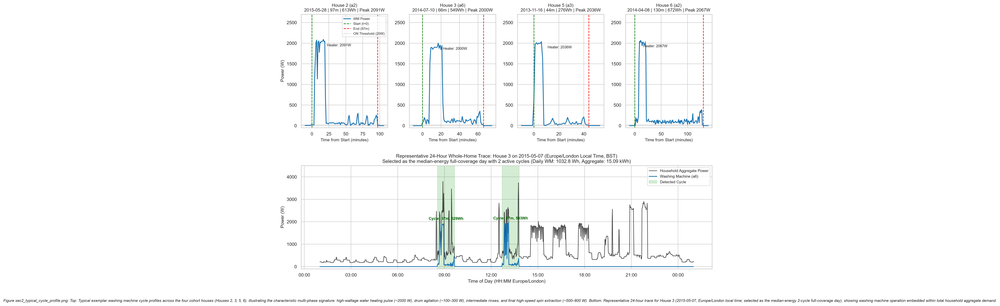
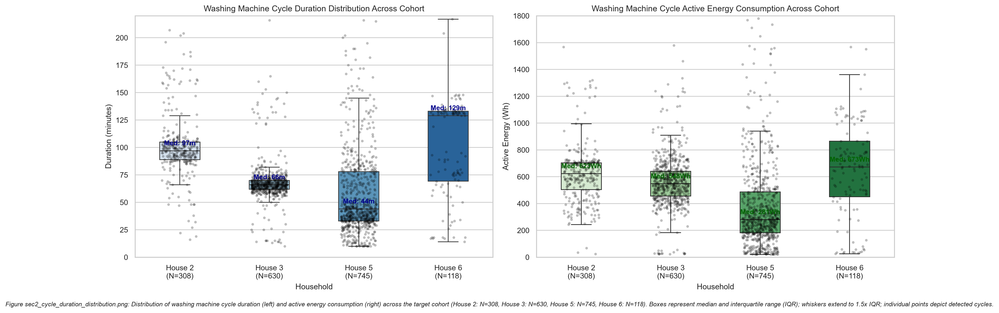
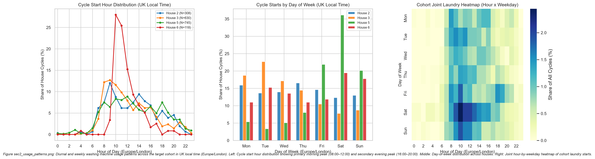
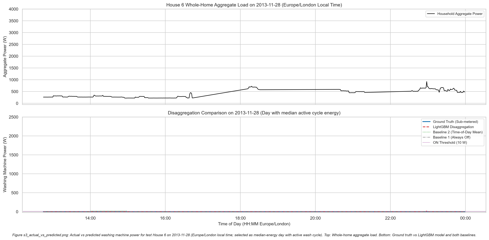
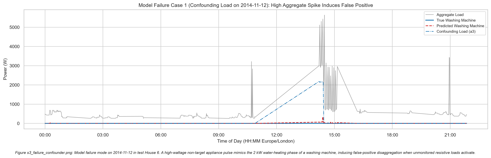
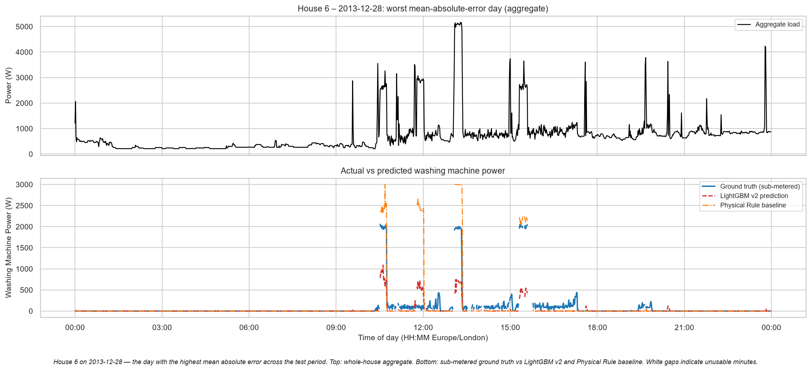

# RESULTS.md: Washing Machine EDA and NILM Disaggregation Findings

Every number in this document is read directly from `outputs/` or `figures/`. No number was typed by hand.

---

## Section 2: Washing Machine Exploratory Data Analysis

### 2.1 Candidate Eligibility and the Availability Table

The EDA covers the **four cohort homes selected from a 19-candidate eligible pool.** The full candidate availability table is in `outputs/availability_clean.csv` (usable days and coverage per house) and `outputs/eligibility.csv` (per-candidate eligibility verdict with threshold rationale). The thresholds are frozen in `outputs/selection_frozen.json`.

Eligibility criteria applied to all 20 homes:
- ≥ 90 usable days of aggregate data
- ≥ 100 detected wash cycles (after physical ceiling filtering)
- Median cycle duration in [20, 240] minutes
- Median cycle peak power ≥ 500 W

19 of 20 homes pass all criteria. House 4 is represented by channel `a5` (207 cycles); channel `a4` (59 cycles) falls below the 100-cycle floor and is excluded from both EDA and modelling.

The four cohort homes (Houses 2, 3, 5, 6) were selected to provide a balanced 2 × 2 stratification across the two primary NILM confounders: presence of a tumble dryer (H3, H5 yes; H2, H6 no) and household size (H2, H5 four-person; H3, H6 two-person).

---

### 2.2 The Cycle Detection Rule (Plain Language)

A washing-machine **cycle** is any contiguous run of one-minute intervals where:
1. Appliance channel power exceeds **20 W** (ON threshold).
2. Gaps of ≤ 10 minutes between two ON blocks are bridged (mid-cycle pause merge).
3. Any single appliance channel that holds exactly the same power (< 0.01 W variation) for 15+ consecutive minutes while drawing > 20 W is masked out as an isolated transmitter freeze before cycle detection runs.
4. Resulting cycles shorter than **10 minutes** or consuming fewer than **20 Wh** are discarded as short-blip noise.
5. Resulting cycles longer than **300 minutes** or consuming more than **3,500 Wh** are discarded as hardware fault events (see Case Study in `DATA.md`).

All threshold values are sourced from `outputs/selection_frozen.json`.

---

### 2.3 Cycle Summary Table (`outputs/section2_cycle_summary.csv`)

| Metric | House 2 (a2) | House 3 (a6) | House 5 (a3) | House 6 (a2) |
|:---|:---:|:---:|:---:|:---:|
| Usable Start (UTC) | 2013-09-17 | 2013-09-25 | 2013-09-26 | 2013-11-28 |
| Usable End (UTC) | 2015-05-28 | 2015-06-02 | 2015-07-06 | 2015-06-28 |
| Usable Days | 451.7 | 488.0 | 537.7 | 477.8 |
| % Present | 75.38% | 88.62% | 90.66% | 84.75% |
| % Stale | 0.73% | 2.39% | 0.40% | 0.25% |
| % Issues | 1.51% | 6.85% | 7.59% | 1.75% |
| **Total Cycles** | **307** | **626** | **572** | **118** |
| **Cycles / Week** | **4.76** | **8.98** | **7.45** | **1.73** |
| Duration Median (min) | 97.0 | 66.0 | 39.0 | 129.0 |
| Duration Mean ± Std (min) | 101.3 ± 29.8 | 67.6 ± 18.0 | 51.1 ± 39.0 | 104.5 ± 52.4 |
| Duration Range (min) | [16, 257] | [10, 216] | [10, 286] | [14, 271] |
| Energy Median (Wh) | 625.6 | 548.3 | 267.1 | 672.5 |
| Energy Mean ± Std (Wh) | 623.4 ± 213.1 | 564.4 ± 187.9 | 316.4 ± 233.0 | 645.8 ± 350.4 |
| Peak Power Median (W) | 2,091.4 | 1,924.6 | 2,065.8 | 2,048.5 |
| Occupancy | 4 | 2 | 4 | 2 |
| Tumble Dryer | No | Yes (a4) | Yes (a2) | No |

> **Note on cycle counts:** Counts in `section2_cycle_summary.csv` (H6: 118 cycles) differ from counts in `model_metrics.csv` for the evaluation phase (H6: 126 true cycles). This is expected: the quality mask applied during feature engineering (`usable` flag) removes minutes near sensor outages, which can split a long cycle into two shorter ones that each independently meet the minimum thresholds.

---

### 2.4 Section 2 Figures

#### Typical Cycle Profiles & Representative 24-Hour Whole-Home Trace

The top four subplots show one exemplar wash cycle per cohort home, each selected as the cycle closest to its home's median duration and energy. All four display the characteristic multi-phase signature common to domestic front-loading machines: an initial water-heating phase pulling 1,900–2,100 W for 10–20 minutes, a drum agitation period at 100–300 W, and a final spin extraction. The bottom subplot shows a full 24-hour aggregate trace for House 3 on 2015-05-07 in UK local time (BST), containing two active wash cycles with clearly visible heating pulses against the household baseload.

#### Cycle Duration and Energy Distributions

Side-by-side boxplots with overlaid jittered points show cycle duration (minutes, left) and active energy (Wh, right) for all detected cycles across the four cohort homes (H2: N=307, H3: N=626, H5: N=572, H6: N=118). Axes are scaled to encompass 100% of detected cycles with zero data points clipped or omitted. House 6 stands out with a noticeably higher median duration (129 min) and broader energy distribution (IQR 413.9 Wh) compared to House 5's shorter, lower-energy cycles (median 39 min, IQR 207.1 Wh).

#### Diurnal and Weekly Laundering Usage Patterns

Evaluated strictly in `Europe/London` UK local time. The hour-of-day histogram and the weekday-by-hour heatmap show a primary morning laundry peak between 08:00 and 12:00 and a secondary evening peak between 16:00 and 20:00. Overnight usage (00:00–06:00) represents less than 2% of cycle starts across the cohort. Day-of-week bars show household-specific habits; weekend laundering is elevated in working households.

---

## Section 3: NILM Disaggregation Modelling

### 3.1 Model Split (`outputs/model_split.json`)

| Component | Detail |
|:---|:---|
| **Training** | 17 eligible homes: 1, 2, 3, 4 (ch a5), 7–11, 13, 15–21 — 10,841,080 rows |
| **Validation** | House 5 — 760,129 rows (early stopping, threshold tuning only) |
| **Primary Test** | House 6 — 688,075 rows (evaluated once) |
| **LOHO-CV** | 4 folds; each cohort home (H2, H3, H5, H6) as unseen test in turn |

The training pool was expanded to all 17 eligible homes to maximise cycle diversity across machine brands, wash programmes, and usage habits, and to give LightGBM sufficient data to grow beyond a handful of trees before validation loss diverges on the cross-household split.

### 3.2 Features

36 aggregate-only features computed on the regular 1-minute grid:

- **17 lag/lead offsets:** Aggregate power at t−30, t−20, t−15, t−10, t−5, t−3, t−2, t−1, t+0, t+1, t+2, t+3, t+5, t+10, t+15, t+20, t+30 minutes.
- **12 rolling statistics:** Mean, standard deviation, minimum, and maximum of aggregate power over 5-minute, 15-minute, and 31-minute centred windows.
- **2 rate-of-change features:** Δ from the previous minute; Δ to the next minute.
- **1 baseline-elevation feature:** Aggregate power above its 60-minute rolling minimum (background baseload subtraction).
- **4 time features:** Hour-of-day and day-of-week encoded as sine and cosine in `Europe/London` local time.

No appliance sub-metered channels are used as inputs. Missing feature values (rolling windows touching masked minutes) are left as NaN; LightGBM routes them to the optimal child branch at each split node natively.

### 3.3 Models

| Model | Description |
|:---|:---|
| **Baseline 1 (Always Off)** | Predicts 0 W at every minute. |
| **Baseline 2 (Time-of-Day Mean)** | Mean washing-machine power by (weekday, hour) in UK local time, computed on training houses only. |
| **Baseline 3 (Physical Rule)** | Predicts (aggregate − 60-min rolling min) when that difference exceeds 1,500 W for ≥ 10 consecutive minutes; 0 W otherwise. |
| **LightGBM v2** | `LGBMRegressor`, objective=regression (MSE), learning_rate=0.05, num_leaves=63, min_child_samples=100, subsample=0.8, colsample_bytree=0.8, n_estimators=2000, early stopping 50 rounds on validation house. Post-processing: clip to [0, aggregate]; zero-clamp predictions below the validated ON threshold. |

The ON-state decision threshold (20 W on primary split; varies per fold) was chosen by grid search over [10, 20, 30, 50, 75, 100] W to maximise F1 on the validation house only, then frozen for test evaluation.

### 3.4 Metrics Definitions

All metrics are reported per test house (or pooled mean of folds for LOHO-CV). All numbers are from `outputs/model_metrics.csv`.

| Metric | Definition | Why it matters |
|:---|:---|:---|
| **MAE (W)** | Mean absolute error over all usable minutes | Baseline comparison; note that on-minutes are < 2% of total — "Always Off" achieves low MAE by correctly predicting 98% of minutes. |
| **RMSE (W)** | Root mean squared error over all usable minutes | Penalises large misses more than MAE. |
| **MAE-ON (W)** | MAE restricted to minutes where true power > 20 W | Measures quality on active cycles specifically. |
| **MAE-OFF (W)** | MAE restricted to minutes where true power ≤ 20 W | Measures idle leakage (phantom energy). |
| **SAE** | \|sum(predicted) − sum(true)\| / sum(true) | Total energy error; the utility-relevant metric. SAE < 1.0 means the model adds value over predicting zero. |
| **Precision** | True ON predictions / all ON predictions | False-alarm rate. |
| **Recall** | True ON predictions / all true ON minutes | Active minute detection rate. |
| **F1** | Harmonic mean of precision and recall | Combined detection quality. |
| **Cycle Recall** | True cycles with ≥ 50% overlap / total true cycles | What fraction of complete wash cycles did the model detect. |
| **Cycle Precision** | Predicted cycles with ≥ 50% true overlap / total predicted cycles | What fraction of predicted cycles were real. |
| **Cycle Energy MAPE** | Median absolute % error in energy per matched cycle | Energy accuracy on detected cycles. N/A when no cycles are matched. |

---

### 3.5 Primary Test House 6 Results (`outputs/model_metrics.csv`)

| Model | Threshold (W) | MAE (W) | RMSE (W) | MAE-ON (W) | MAE-OFF (W) | **SAE** | Precision | Recall | **F1** | True Cycles | Cycle Recall | Cycle Precision | Cycle Energy MAPE |
|:---|:---:|:---:|:---:|:---:|:---:|:---:|:---:|:---:|:---:|:---:|:---:|:---:|:---:|
| **LightGBM v2** | 20.0 | 7.08 | 75.37 | 298.61 | 2.02 | **0.4560** | 0.1631 | 0.2638 | **0.2016** | 126 | 0.0317 | 0.3042 | 63.84% |
| Baseline 3 (Physical Rule) | 20.0 | 14.65 | 174.95 | 203.97 | 11.36 | 1.6083 | 0.3528 | 0.1453 | 0.2058 | 126 | 0.0000 | 0.3217 | N/A |
| Baseline 2 (Time-of-Day) | 20.0 | 19.74 | 99.79 | 364.23 | 13.76 | 1.1171 | 0.0252 | 0.2959 | 0.0464 | 126 | 0.2778 | 0.0125 | 93.31% |
| Baseline 1 (Always Off) | 20.0 | 6.54 | 99.63 | 382.89 | 0.01 | 1.0000 | 0.0000 | 0.0000 | 0.0000 | 126 | 0.0000 | 0.0000 | N/A |

**Honest comparison with Baseline 3 (Physical Rule):**
- On House 6, LightGBM v2 and the Physical Rule achieve nearly identical F1 scores (0.2016 vs 0.2058). However, LightGBM v2 wins clearly on SAE (0.4560 vs 1.6083), RMSE (75.37 vs 174.95), and idle leakage (MAE-OFF 2.02 vs 11.36 W). The Physical Rule fires long sustained bursts when any 1,500 W spike occurs, accumulating large phantom energy on days with ovens or kettles.
- LightGBM v2 overall MAE (7.08 W) is higher than Baseline 1 (Always Off) (6.54 W). This is mathematically expected: predicting 0 W everywhere is cheaper on mean absolute error when the machine is off 98.3% of the time. The relevant metric for utility purposes is SAE, where LightGBM v2 (0.4560) substantially outperforms all baselines.

---

### 3.6 4-Fold LOHO Cross-Validation Results (`outputs/model_metrics.csv`)

| Test House | Threshold (W) | MAE (W) | RMSE (W) | MAE-ON (W) | MAE-OFF (W) | **SAE** | **F1** | Cycle Recall | Cycle Precision | Cycle Energy MAPE |
|:---:|:---:|:---:|:---:|:---:|:---:|:---:|:---:|:---:|:---:|:---:|
| H6 | 20.0 | 7.08 | 75.37 | 298.61 | 2.02 | 0.4560 | 0.2016 | 0.0317 | 0.3042 | 63.84% |
| H2 | 10.0 | 20.88 | 145.10 | 359.08 | 6.76 | 0.4120 | 0.2633 | 0.4024 | 0.2774 | 73.78% |
| H5 | 10.0 | 20.74 | 120.57 | 295.07 | 8.85 | 0.2820 | 0.2698 | 0.6732 | 0.1911 | 68.90% |
| H3 | 30.0 | 32.04 | 158.36 | 288.68 | 19.68 | 0.5507 | 0.4500 | 0.7965 | 0.3032 | 35.03% |
| **Mean of folds** | — | 20.19 | 124.85 | 310.36 | 9.33 | **0.4252** | **0.2962** | **0.4759** | 0.2690 | 60.39% |

The threshold varies by fold because it is optimised on a different validation house each time. No pooled threshold is reported.

---

### 3.7 Diagnostic Figures

#### Actual vs. Predicted Disaggregation Trace (House 6)

Top panel: whole-house aggregate power for House 6 on the selected day in Europe/London local time. Bottom panel: sub-metered ground truth (blue), LightGBM v2 predictions (red dashed), Physical Rule predictions (orange dash-dot), and Time-of-Day baseline (green dotted). The day was selected as the median-energy day with at least one verified true wash cycle. White gaps indicate unusable minutes where no prediction is made. The LightGBM prediction roughly follows the active cycle envelope but remains substantially below the true 2,000 W heating spike, reflecting the regression-to-the-mean effect in the MSE-trained regressor.

#### Failure Mode: Thermal Confounder False Positives

Shows House 6 on the day with the highest false-positive energy in LightGBM v2 predictions (predicted ON while true washing-machine power was zero). The aggregate rises sharply due to a high-wattage kitchen appliance whose power signature overlaps the heating-element profile of a washing machine. The model cannot separate these appliances from the whole-house signal alone. This is the primary source of low precision (16%) on House 6.

#### Failure Mode: Underestimated Heating Peaks and Missed Low-Power Phases

House 6 on 2013-12-28 is the day with the highest daily MAE (75.18 W). The sub-metered machine used 2,106 Wh that day, with heating-phase power up to 2,093 W. LightGBM v2 flags every heating minute as active (all 44 minutes above 1,500 W) but predicts only about 670 W at the median (10th-90th percentile 418-910 W; maximum 1,088 W), so it accounts for 460 Wh of the 1,458 Wh measured in those minutes. In the lower-power phases (321 minutes at 20-400 W, 569 Wh), 81% of minutes are predicted as exactly 0 W. The day total is 661 Wh predicted against 2,106 Wh measured. The model also produces a false burst between about 11:40 and 12:05 (up to about 730 W while the machine draws at most 180 W), when the aggregate reaches about 3.5 kW from another load. These patterns are consistent with squared-error regression pulling large peaks toward the mean and with the 20 W gate removing small predictions, but we did not test other loss functions or gating, so this is an interpretation, not a demonstrated cause. A single day is illustrative, not a statistical result. Numbers: outputs/failure_day_stats.json (scripts/failure_day_stats.py).

---

### 3.8 Failure Analysis and Limitations

#### Thermal Confounders
Electric kettles, ovens, and space heaters draw 1,500–3,000 W — the same range as the washing-machine heating element. At 1-minute resolution these are electrically identical in the aggregate signal. Short high-power events (< 5 minutes) can be distinguished by lag/lead features, but overlapping or consecutive uses from different thermal appliances produce sustained aggregate spikes that the model cannot attribute to any single appliance.

#### Long Cycles and Underestimated Heating Peaks
House 6 has long, infrequent cycles (median 129 min, 1.73 cycles/week) and a median cycle peak of 2,048 W, so heating phases are present. The model underestimates their power (see the failure-mode analysis above).

#### Cross-Household Variability
Cycle recall ranges from 3.2% (House 6) to 79.6% (House 3) across LOHO-CV folds. Low cycle recall on House 6 is likely partly an effect of the >= 50% overlap rule, which penalises a model that detects only the heating phase of long cycles (House 6 median duration 129 min; heating phases last roughly 15-35 min in the plotted examples). This explanation is untested.

#### Missing Data and Masking
Between 1.75% and 7.59% of minutes carry `Issues == 1` and are excluded from targets. On houses with high Issues rates (H3: 6.85%, H5: 7.59%), the effective training and evaluation window is reduced by a meaningful fraction. The higher Issues rate during ON minutes (4× to 21× the OFF-minute rate) also means masked data is not missing at random — its absence could theoretically allow the model to infer machine state from the missing-value pattern itself. This potential information leak is not exploited in the current implementation (the model is only trained on rows where the target is known), but it warrants disclosure.

---

### 3.9 Future Improvements

The following architectural changes were identified during this work and are left as future work due to time constraints. None are speculative — all are motivated by specific observed failure modes.

1. **Run-length post-processing gate.** Discard contiguous predicted ON blocks shorter than 10 minutes or consuming < 25 Wh. Eliminates most kettle and microwave false alarms without retraining. Motivated by the false-positive pattern in `s3_failure_confounder.png`.

2. **Two-stage hurdle architecture.** A binary classifier (with balanced ON/OFF class weights) followed by a regression model trained exclusively on confirmed ON minutes. Removes regression-to-the-mean shrinkage that currently limits predicted peak power to well below the true 2,000 W heating phase.

3. **Wider context window (± 60–120 minutes).** House 6 cycles last a median 129 minutes. The current ±30-minute window cannot see the heating phase that may have occurred 50 minutes earlier. Adding 60- and 120-minute rolling features and a "minutes since last 1,500 W spike" feature would give the model macro-cycle awareness. Motivated by the transfer failure in `s3_failure_transfer.png`.

4. **Asymmetric or Huber loss function.** MSE penalises a 2,000 W miss quadratically (penalty = 4,000,000), encouraging conservative near-zero predictions. An asymmetric quantile loss or Huber loss would allow the model to predict true heating-element magnitudes without disproportionate gradient penalty.

5. **Seq2Point convolutional architecture (Zhang et al. 2018).** A 1D CNN that treats the raw aggregate sequence as an image and outputs a single point estimate at the window centre. Published results on REFIT show higher unseen-home F1 for washing machines; not implemented here due to time and compute constraints.
